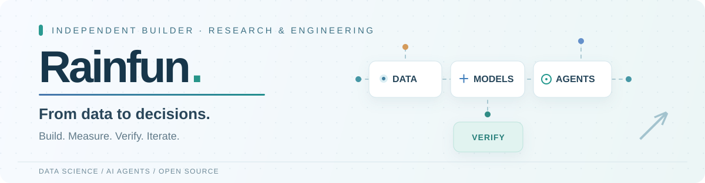

  

   

  **Applied Statistics · Data Science · AI Agent Engineering**

  从数据、模型到 Agent 和实际产品。 
  我喜欢把想法变成可运行的系统，也希望每个结论都有证据、每次改进都能验证。

  

    <a href="https://hccccc01333.github.io/">Website</a> ·
    <a href="https://www.kaggle.com/afterrain42">Kaggle</a> ·
    <a href="mailto:rainfun446@gmail.com">Email</a> ·
    <a href="https://github.com/hccccc01333?tab=repositories">All repositories</a>
  

---

## Overview / 研究与开发版图

我的主要方向不是某一种模型或框架，而是 **把统计分析、机器学习、Agent 工程和产品开发连接起来**。不同领域解决不同问题，但都遵循同一套思路：**定义问题 → 构建基线 → 实现方案 → 验证结果 → 迭代改进**。

| 领域 | 在解决什么问题 | |
| :-- | :-- | :-- |
| **01 · AI Agents & Applications** | 让 AI 在真实业务场景中完成多步任务 | [项目 ↓](#agent-apps) |
| **02 · Evaluation & Reliability** | 判断 Agent 的输出是否正确、稳定、可复现 | [项目 ↓](#agent-eval) |
| **03 · Data Science & Statistics** | 用统计、实验和机器学习把数据变成可信结论 | [项目 ↓](#data-science) |
| **04 · Esports Intelligence** | 用赛事数据、建模和工具支持赛训分析与决策 | [项目 ↓](#esports) |
| **05 · Developer Tools & Open Source** | 改进 AI Coding、工具调用与开发者工作流 | [项目 ↓](#dev-tools) |

**Selected results:** Kaggle [ROGII Geology Prediction](https://github.com/hccccc01333/rogii-487th-place-solution) **487 / 6,125 (Top 8%)** · [AI Agent Security](https://github.com/hccccc01333/ai-agent-security-redteam) **Bronze Medal**

 

## 01 / AI Agents & Applications
AGENT PRODUCTS · TOOL USE · WORKFLOWS

**让 Agent 真正做事，而不是只生成回答。** 我关心它如何理解任务、调用工具、管理状态，以及把结果交付给用户。

- **[dsh-excel-chat](https://github.com/hccccc01333/dsh-excel-chat)** — 自然语言驱动 Excel 操作；围绕 **执行 → 公式校验 → 自动修复 → 复验** 构建可追踪的工作流。
- **[taptap-hotspot-intel](https://github.com/hccccc01333/taptap-hotspot-intel)** — 游戏热点研究 Agent：多源信号采集、证据检索、事件整理与增长创意生成。
- **[game-user-insights-agent](https://github.com/hccccc01333/game-user-insights-agent)** — 公开行为数据 → 用户画像与沉默风险 → Agent 分析与干预决策；包含离线验证思路。

 

## 02 / Evaluation & Reliability
BENCHMARKS · VERIFICATION · AGENT SAFETY

**Agent 的能力需要测量，不能只靠演示。** 我更关注成功率、失败归因、评测协议和不确定性的边界。

- **[dsh-eval](https://github.com/hccccc01333/dsh-eval)** — DeepSeek Harness 评测工具；支持运行轨迹、任务成功率、成本统计、配对实验与可靠性分析。
- **[caliber](https://github.com/hccccc01333/caliber)** — Data Agent 的**指标口径评测集**；研究歧义、错误 Join、时间范围和数据缺失下是否会误答。
- **[skillproof](https://github.com/hccccc01333/skillproof)** — 将浏览器任务转化为可执行 Agent Skill，并为任务完成情况提供检查依据。
- **[AI Agent Security Red Team](https://github.com/hccccc01333/ai-agent-security-redteam)** — Kaggle 铜牌研究；记录多步工具调用安全实验、对照结果与复现流程。

 

## 03 / Data Science & Statistics
STATISTICAL INFERENCE · MACHINE LEARNING · BUSINESS ANALYTICS

**先把问题、数据和指标定义清楚，再谈模型。** 关注 EDA、统计推断、实验设计、特征工程和结果解释。

- **[ROGII Wellbore Geology Prediction](https://github.com/hccccc01333/rogii-487th-place-solution)** — Kaggle **487 / 6,125（Top 8%）**；多源序列回归、缺失数据处理、特征与模型融合。
- **[SPSS Data Analysis Portfolio](https://github.com/hccccc01333/spss-data-analysis-portfolio)** — 游戏分析案例：玩家问卷、留存 A/B 实验、关卡异常与付费流失。
- **[Power BI Retail Analysis](https://github.com/hccccc01333/powerbi-retail-analysis)** — 零售经营指标体系和 BI 看板，分析销售、毛利、渠道、商品与目标达成。

 

## 04 / Esports Intelligence
KPL · MATCH ANALYTICS · DRAFT STRATEGY

**把赛事数据从“展示统计”推进到“支持复盘与决策”。** 这个方向融合了数据采集、建模、产品设计与策略研究。

- **[KPL Scrim Lab](https://github.com/hccccc01333/kpl-scrim-lab-app)** — 本地赛训数据平台；对局采集、OCR 核对、数据溯源、选手/英雄分析、BP 与训练赛复盘。
- **[KPL Research](https://github.com/hccccc01333/kpl-research)** — 从赛事数据采集到比赛预测、战队/选手比较、时间序列分析与复盘的研究项目。
- **[KPL Data Site](https://github.com/hccccc01333/KPLdata-site)** — 上述研究的交互展示端；[在线体验](https://hccccc01333.github.io/KPLdata-site/)。

**持续探索：** Ban/Pick 决策建模、序列决策、多步搜索和强化学习。研究中会刻意区分**模仿专家决策**与**提高真实胜率**这两类不同目标。

 

## 05 / Developer Tools & Open Source
AI CODING · MCP · DEVELOPER EXPERIENCE

**把自己遇到的开发摩擦做成别人也能使用的工具。** 侧重可组合、可审计、可复现，而不是增加不必要的复杂度。

- **[MCP Router](https://github.com/hccccc01333/mcp-router)** — 对大量下游 MCP 工具做统一接入与按需检索，缓解工具数量与描述预算限制。
- **[Codex DeepSeek Mini-Router](https://github.com/hccccc01333/codex-deepseek-mini-router)** — 面向不同任务的模型提示与路由实验，附对照基线。
- **[Codex Bridge Toolkit](https://github.com/hccccc01333/codex-bridge-toolkit)** — 将网页端模型的规划与本地 Codex / OpenCode 执行连接起来。
- **[ContextRelay](https://github.com/hccccc01333/trae-context-relay)** — 基于 Git 和文件证据实现 AI Coding 跨会话状态交接与恢复。
- **[awesome-dsh-plugin](https://github.com/hccccc01333/awesome-dsh-plugin)** — DeepSeek Harness 插件生态整理与社区资源索引。

---

### How I work

**Problem → Data → Baseline → Build → Evaluate → Improve**

我倾向于把**方法、代码、实验结果和已知限制**一起公开。失败实验也是研究结果；一个演示能跑通，并不等于它已经可靠。

欢迎通过相关仓库的 **Issues / Pull Requests** 交流具体问题、复现结果与改进建议。

  <a href="https://github.com/hccccc01333?tab=repositories">Explore all repositories</a> · <a href="mailto:rainfun446@gmail.com">Contact</a>

